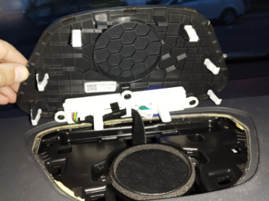
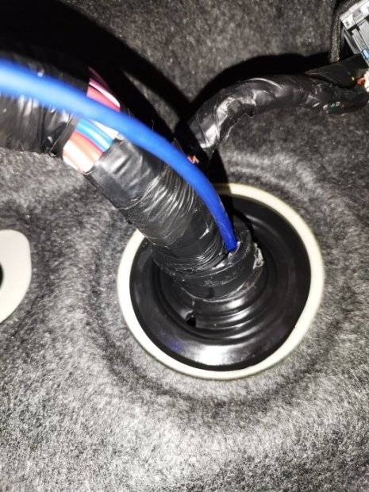
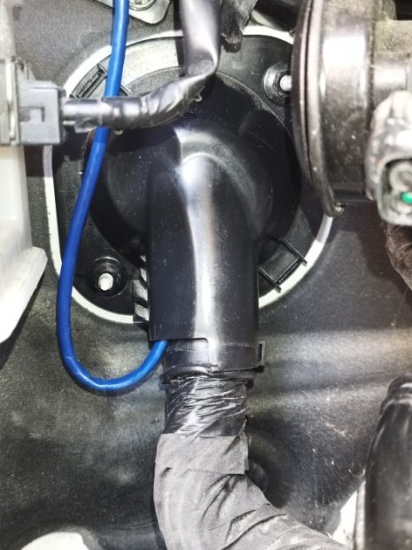
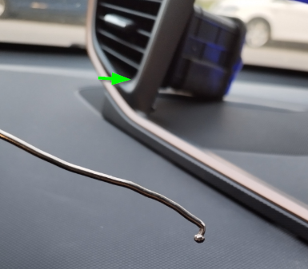
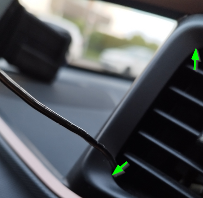
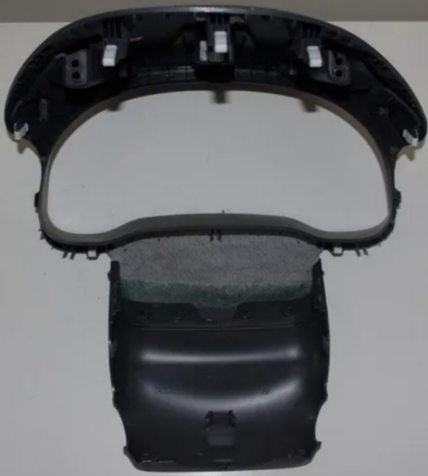
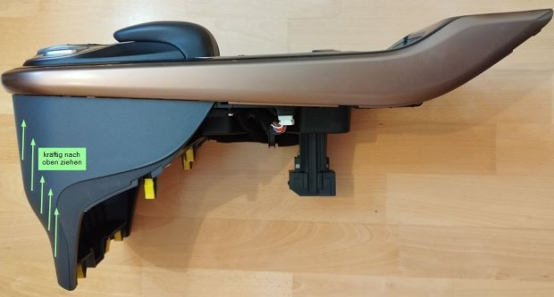
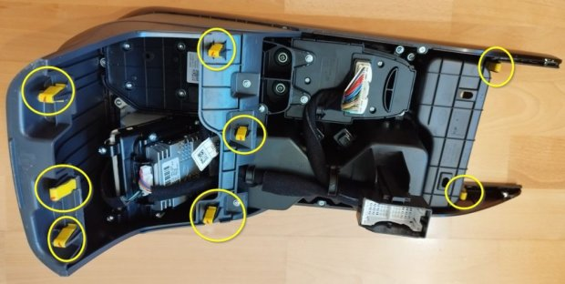

# Selbstgemacht beim Hyundai Ioniq

Diese Seite sammelt Tips und Tricks, um selber am Ioniq zu werkeln. Empfohlende Sortierung: Alphabetisch

Diese Seite lebt (mehr oder weniger sychronisiert) an zwei Plätzen:
- im goingelectric Wiki https://www.goingelectric.de/wiki/Hyundai-Ioniq-Do-It-Yourself
- auf github https://github.com/uhi22/Ioniq28Investigations/tree/main/do-it-yourself

## Repair-Manuals

https://www.hioniqae.com/hyundai_ioniq_ae_2017_2022_service_repair_manual-413.html
(Die Anleitung nennt sich "AE", was eigentlich der voll-elektrische ist, aber es geht um den Hybrid.)

## Armaturenbrettabdeckung entfernen

Die mittlere Armaturenbrettabdeckung, unter der der Center-Speaker sitzt und die auch die blaue Dreifachladeanzeige enthält, lässt sich ohne Werkzeug entfernen. Am ungefährlichsten ist es, dazu die Headunit auszubauen (siehe unten), und dann die weißen Einrastelemente von unten nach oben zu drücken. Ist das erste locker, kann man mit den Fingern oben zwischen Abdeckung und Armaturenbrett reinzwängen und die restlichen Klipse lösen.

*Abgenommene Abdeckung (Rückseite mit den weißen Einrastelementen) und der darunter sitzende Center-Speaker.*

## Akustik: Schalldämmung

siehe https://www.goingelectric.de/forum/viewtopic.php?t=100879

## Bremsbacken/Scheiben ausbauen / Bremsen gangbar machen / entrosten

Siehe https://www.goingelectric.de/forum/viewtopic.php?p=1945593#p1945593

und https://www.goingelectric.de/forum/viewtopic.php?p=2014256#p2014256

Benötigtes Werkzeug: Wagenheber, Vorlegeklötze, Radkreuz, 14er Nuss oder Ringschlüssel, ggf mit Verlängerung, 17er Maulschlüssel. Kreuzschlitzschraubendreher. Drahtbürste, ggf. Schleifpapier und/oder Schaber. Benötiges Material: Lösungsmittel zum Reinigen, Fett, ggf. Zinkspray.

Beschreibung für die hinteren Bremsen

Feststellbremse nicht anziehen. Fahrzeug mit Vorlegeklötzen sichern. Hinterrad demontieren. Zwei Schrauben (SW14) am Bremssattel entfernen, dabei ggf. mit Maulschlüssel SW17 gegenhalten, so dass die Gummimanschetten der Gleitbolzen nicht beschädigt werden. Bremssattel nach oben abziehen und so lagern, dass weder Bremsschlauch noch Kabel unter Zugspannung kommen. Bremsbeläge ausklipsen, ggf. mit großem Schraubendreher etwas hebeln. Weitere zwei SW14-Schrauben entfernen, so dass der Bremssattelträger abnehmbar ist. Kreuzschlitzschrauben an der Bremsscheibe entfernen, und Bremsscheibe abnehmen (ggf mit Faust oder Holzhammer einen leichten Schlag von hinten geben, falls sie festgebacken ist. Die beiden Klemmbleche vom Bremssattelträger abziehen.

Alle Teile gut von Rost und Fettresten befreien. Falls die Scheiben starke Rostringe haben, diese gründlich entfernen (Schaber, Feile, Schleifpapier). Die Bremsbeläge mit Schleifpaper plan abziehen. Die Gleitbolzen durch leichte Dreh- und Schiebebewegungen gangbar machen. Falls die zu fest sind, ausbauen, reinigen, neu fetten.

Zum Schluss in umgekehrter Reihenfolge wieder zusammenbauen. Die Gleit- und Berührungsstellen der beweglichen Teile mit geeignetem Fett versehen.

Vorsicht: Falls neue Scheiben oder Beläge eingebaut werden sollen, müssen die Bremskolben zurückgedreht werden. Das geht entweder über Diagnose, oder, laut Video in https://www.goingelectric.de/forum/viewtopic.php?p=2369540#p2369540 kann man einfach 12V an den Parkbremsenaktuator anlegen, der dreht dann ja nach Polarität zu oder auf.

## Chargeport-Stellmotor wechseln

siehe https://www.goingelectric.de/forum/viewtopic.php?p=2240347#p2240347

## EPCU (Elektromotor-Steuergerät, Inverter, DC-DC-Wandler)

https://www.goingelectric.de/forum/viewtopic.php?p=2237862#p2237862

Ioniq28Investigations/EPCU_ElectronicPowerControlUnit at main · uhi22/Ioniq28Investigations (github.com)

## Frontverkleidung/Stoßfänger demontieren und zerlegen

z.B. zwecks Lackierung der "Nase": https://www.goingelectric.de/forum/viewtopic.php?p=567275#p567275

## Heckspoiler befestigen

Benötigtes Werkzeug: Nuss 10mm

Benötigtes Material: keines (ggf wird Loctide empfohlen, um das erneute Lösen zu verhindern)

Der Heckspoiler ist mit sieben Muttern (M6, SW10) an der Heckklappe befestigt. Diese lösen sich gern mal nach einigen Zehntausend Kilometern, was zu Klappergeräuschen führt.

Drei sitzen unter der mittleren Innenverkleidung der Heckklappe, und jeweils zwei ganz links und rechts außen unter runden Gummistopfen.

## Kabel durch die Spritzwand

Fragestellung: Wo kann man ein Kabel vom Innenraum in den Motorraum ziehen?
Diskussion: https://www.goingelectric.de/forum/viewtopic.php?f=116&t=63297

Antwort: Drei Möglichkeiten bieten sich an:

Nutzung der vorhandenen Kabeldurchführung im Fahrerfußraum.
Benötigtes Werkzeug: 10er Nuss oder Steckschlüssel. Seitenschneider.
Im Motorraum die zwei M6-Muttern an der Durchführung entfernen. Ggf. die davor liegende Hupe entfernen, so dass man mehr Platz hat. Den Kabelbinder an der Durchführung entfernen. Nun lässt sich die Plastik-Abdeckung der Durchführung entfernen. Zu Tage tritt ein sehr weiches Gummiteil. In dieses im oberen Bereich mittels Seitenschneider ein kleines Loch schneiden. Von der Innenraumseite mit einem festen Draht oder Schraubendreher einen Durchgang herstellen und dort das gewünschte Kabel durchführen. Abschließend die Plastikkappe wieder montieren und mit neuem Kabelbinder den Kabelbaum und die Kappe verzurren.

*Innenraumseite: das weiche Gummiteil der Durchführung, durch das hier ein blaues Kabel gezogen wurde.*

*Motorraumseite: die Plastik-Abdeckung der Durchführung mit dem durchgeführten Kabel.*

Nutzung der vorhandenen Kabeldurchführung im Beifahrerfußraum. Nachteile: Im Motorraum sieht man orange Kabel. Das heißt: Vorsicht, gefährliche Spannungen. Und im Innenraum ist die Durchführung hinter dem Lüfter versteckt, so dass man ganz schlecht bis gar nicht ran kommt.
Nutzung des Kondensat-Schlauchs im Beifahrerfußraum.https://www.youtube.com/watch?v=qGcqHyG0cRA&t=39s

## Klimaanlage

Verdampfer tauschen (im Innenraum hinter dem Armaturenbrett): https://www.goingelectric.de/forum/viewtopic.php?p=2340544#p2340544

Kondensator tauschen (in der Front): https://www.goingelectric.de/forum/viewtopic.php?p=2256878#p2256878

## Innenraumfilter wechseln

Benötigtes Werkzeug: keines.

Der Filter sitzt hinter dem Handschuhfach. Um dieses vollständig zu öffnen, die beiden "Stöpsel" links und rechts im Handschuhfach entgegen dem Uhrzeigersinn drehen und entnehmen. Dann das Handschuhfach bis zum Anschlag herunterklappen. Hinter dem Handschuhfach wird ein schmaler Deckel sichtbar. Rechts und links ist dieser mit "Einschnappern" versehen. Diese mit Daumen und Zeigefinger vertikal zusammendrücken. Der Deckel löst sich und der Filter kann entnommen werden.

## CAN-Bus im Motorraum anzapfen

Benötigtes Werkzeug: Lötkolben. Benötigtes Material: Pfostensteckerleiste (teilbar), Kabel

Im Motorraum finden sich verschiedene CAN-Busse, beispielsweise

Der Diagnose-CAN, der auch an der OBD-Buchse im Innenraum anliegt. Motorraum, auf dem rechten Radkasten, unter einer Kappe befindet sich eine (Hyundai-spezifische?) Diagnose-Buchse. Rastermaß ca. 3,5mm, dreireihig. In der oberen Reihe der 5. Pin von links ist CANL, darunter CANH.
Weiterer CAN auf der selben Buchse. Obere Reihe, zweiter Pin von links ist CANL, darunter CANH. Baudrate: 500k.
"Motor-CAN": Hinter dem rechten Scheinwerfer (unter der "Hyundai-Diagnosebuchse") ist an der Karosserie ein grauer "Blindstecker" eingeclipst, in den von unten ein zweireihiger Stecker gesteckt ist. Der "Blindstecker" besteht aus zwei Brücken. Jede Brücke verbindet einfach alle 7 Kontakte einer Reihe. Eine Reihe ist CANL, die andere CANH. Der gleiche CAN liegt an den Steckern von Onboard-Charger (in Motorraum-Mitte, untere Box) und am Motor-Steuergerät (Motorraum-Mitte, obere Box), sowie am "Bremspedal-Steuergerät" (beim "Bremskraftverstärker") an. Aderfarben orange und grün. Baudrate: 500k.
Um diesen CAN anzuzapfen, kann der originale Brückenstecker durch einen Eigenbau ersetzt werden, der aus den einzelnen Pins einer 2.54mm Steckerleiste im passenden Raster besteht. Dort kann ein Kabel direkt angelötet werden. VORSICHT: Eine Unterbrechung oder Kurzschluss an dieser Stelle legt vermutlich den Antrieb lahm. Nur im Stand benutzen und vor jeder Fahrt auf den Originalzustand zurückbauen.
"Radar-CAN": Ein gleichartiger "Verteiler-Blindstecker" wie bei (3) befindet sich auch in der Nähe des Front-Radars. Aderfarben hier schwarz und rot.

## Rücksitzbank ausbauen

Benötigtes Werkzeug: Kreuzschlitzschraubendreher, Nuss 13mm. Benötigtes Material: Keines.

Kofferraum ausräumen, alle losen Ablagen aus dem Kofferraum entfernen. Die Kofferraum-Bodenverkleidung abschrauben (4 Kreuzschlitzschrauben). Kofferraumbodenverkleidung rausnehmen. Rückenlehnen nach vorn umklappen. Zwischen den beiden Lehnenhälften befindet sich eine M8-Schraube (dort, wo beide Lehnenhälften ihre gemeinsame Lagerung haben). Diese Schraube komplett entfernen. Den Bügel, den diese Schraube hielt, nach hinten klappen. Jetzt sind die Gelenke der Lehnenhälften freigelegt und diese lassen sich nach hinten-oben herausnehmen. Die Drehpunkte nahe der C-Saulen sind eingerastet und lassen sich durch kräftiges Ziehen in Richtung Fahrzeugmitte lösen. Die "Einhakung" bricht ggf. dabei ab, aber das stört nicht, weil die im eingebauten Zustand bedeutungslos ist. Nachdem die Lehnenteile entfernt wurden, finden sich zwei M8-Schrauben, die die Sitzbank hinten sichern. Zwei Schrauben entfernen. Stecker an der Sitzbank abstecken (Sitzheizung und Sitzbelegungserkennung). Vorn ist die Bank nur links und rechts eingerastet, kräftig nach oben ziehen löst die Verbindung zerstörungsfrei.

## Dash-Cam einbauen

https://www.goingelectric.de/forum/viewtopic.php?p=1093177#p1093177

## Head-Unit ausbauen

https://www.youtube.com/watch?v=H3Uhaf-KPV8

Der Rahmen mit den Lüftungsauslässen lässt sich abziehen. Dazu zum Beispiel aus einem Kleiderhaken, der am Ende eine kugelförmige Verdickung hat, einen kleinen Haken biegen. Dessen Kugelkopf rastet dann gut im unsichtbaren Bereich in den Ecken der Luftauslässe ein, so dass man kräftig ziehen kann, ohne Spuren zu hinterlassen. An vier Ecken jeweils kräftig ziehen.

*Aus einem Kleiderhaken gebogener Haken mit kugelförmigem Ende.*

*Der Kugelkopf rastet im unsichtbaren Bereich in der Ecke des Luftauslasses ein (Pfeile), so kann man kräftig ziehen.*

Dann sind es noch vier Kreuzschlitzschrauben, und im unteren Bereich rechts und links jeweils einmal kräftig ziehen, dann ist die Headunit herausnehmbar.

## Kombiinstrument ausbauen

Benötigtes Werkzeug: Kreuzschlitzschraubendreher. Benötiges Material: Keines.

Schritt 1: Haube über dem Kombi entfernen. Diese ist mit 7 Clips befestigt.

Schritt 2: Blende entfernen. Die Blende des Kombis, die obere Schale der Lenksäulenabdeckung bilden mit dem "flexiblen Lederzwischenstück" ein Teil. Die Oberschale der Lenksäulenabdeckung lässt sich mit seitlichem Druck und gleichzeitigem Nach-Oben-Schieben ausklipsen.

*Abgenommene Blende des Kombis – Blende, Oberschale der Lenksäulenabdeckung und das "flexible Lederzwischenstück" bilden ein Teil.*

Schritt 3: Kombi ist mit vier Kreuzschlitzschrauben befestigt.

## Mittelkonsole ausbauen

Benötigtes Werkzeug: Nuss 10mm, Kreuzschlitzschraubendreher. Benötigtes Material: Keines

Teil 1: Mittelkonsolenbedienteil ausbauen. Das geht ohne Werkzeug. Im vorderen, unteren Bereich fest packen und nach oben ziehen. Ggf. leicht schräg, erst die eine Seite, dann die andere Seite. Wenn es vorn locker ist, weiter nach hinten arbeiten, bis alle 8 Clipse ausgerastet sind.

*Ausgebautes Bedienteil – im vorderen, unteren Bereich kräftig nach oben ziehen.*

*Unterseite mit den 8 markierten Clipsen (gelb), die nacheinander ausrasten.*

Teil 2: Mittelkonsolenunterteil ausbauen. Im Fußraum von Fahrer und Beifahrer geht die Mittelkonsole in jeweils eine Abdeckung über, die mit einer schwarzen Plastik-"Schraube" gesichtert ist. Diese herausdrehen und den schwarzen "Dübel" herausziehen. Die Blenden abnehmen. Sind etwas verwinkelt mit der Karosserie verklipst und mit der Mittelkonsole "verstiftet". Jede Blende hat zwei Klipse zur Karosserie, man muss die Blende in Richtung Tür ziehen und dabei die Wange der Mittelkonsole ein bis zwei Zentimeter mitbiegen. (Gfg. kann man die Abdeckungen auch dran lassen. Die Mittelkonsole lässt sich auch bei noch montierten Abdeckungen nach hinten wegziehen.) Im Boden des großen Staufachs unter der Mittelarmlehne liegt eine Filzmatte. Diese entfernen. Zwei darunterliegende M6-Schrauben entfernen. Unter dem Mittelkonsolenbedienteil (siehe oben) befinden sich zwei weitere M6-Schrauben.

## Motor ausbauen / Motorlager tauschen / Getriebelager tauschen

Motorlager: https://www.youtube.com/watch?v=LbhKwf43rKQ

Motorlager / Getriebelager Beschaffung und Austausch: Motorschaden Ioniq - zum Anhören - Seite 18 - IONIQ - Antrieb, Elektromotor • Hyundai IONIQ Elektro - Elektroauto Forum

## Raddrehzahlsensor hinten wechseln

Video verlinkt in https://www.goingelectric.de/forum/viewtopic.php?p=2369540#p2369540

Radlager wechseln
Vorne: https://www.goingelectric.de/forum/viewtopic.php?p=2238091#p2238091

## Türgriffe

### Türgriff-Außenschalen abbauen

Benötigtes Werkzeug: Torx6

Griff ziehen. Hinten ist eine Torx-Schraube, diese rausdrehen. Hinteren Bereich der Türgriff-Außenschale vom Fahrzeug weg ziehen. Die obere und untere Hälfte spreizen sich dabei geringfügig auf. Nicht versuchen, die obere und untere Hälfte zu trennen, die sind innerlich verschraubt. Nachdem der hintere Bereich ca. 1 bis 2cm gelöst ist, Außenschale nach vorn schieben (nicht nach der Seite hebeln, sonst bricht vorn der Einraster ab).

### Türgriff insgesamt ausbauen

Siehe https://www.goingelectric.de/forum/viewtopic.php?p=2229652#p2229652

## Verkleidungen abbauen

### Innenverkleidung Schweller entfernen

Benötigtes Werkzeug: keines. Benötigtes Material: Keines.

Die Türdichtung im Schwellerbereich ist nur aufgesteckt und lässt sich nach oben abziehen. Danach lässt sich die Plastikverkleidung der Schweller-Innenseite nach oben durch kräftiges Hochziehen zerstörungsfrei abnehmen. 

### Innenverkleidung B-Säule entfernen

Benötigtes Werkzeug: keines. Benötigtes Material: Keines.

Nachdem die Schweller-Innenverkleidung weg ist (siehe oben), lässt sich die Verkleidung der B-Säule in Richtung Fahrzeugmitte ausklipsen. Davor die Gurtbefestigung im hinteren Fußraum nach unten drehen. Nicht abschrauben. Der schwierigste Teil ist oben mittig. Nicht verkanten, sondern sauber in Richtung Fahrzeugmitte ziehen.

### Innen-Verkleidung der Heckklappe entfernen

Benötigtes Werkzeug: keines. Benötigtes Material: Keines.

Die waagerechte innere Verkleidung der Heckklappe (zwischen den beiden Scheiben) ist nur eingeklipst. Die Klipse vertragen auch mehrfache Demontage / Montage zerstörungsfrei. Zwischen der großen Heckscheibe und der Verkleidung ist ein Spalt von einigen Millimetern Breite. In diesen mit drei Fingern reinzwängen und fest ziehen. Die Verkleidung löst sich. An einer Seite beginnen, und Schritt für Schritt zur anderen weiterarbeiten.

### Türverkleidung abbauen

Benötigtes Werkzeug: Kreuzschlitzschraubendreher, Kunststoffkeil.

Bei den vorderen Türen zuerst die Verkleidung vom Spiegeldreieck abnehmen. Dazu zwischen Scheibe und Dreieck reinzwängen und Richtung Fahrzeugmitte ausklipsen.

In der inneren Türgriffmulde liegt eine Gummimatte. Diese herausnehmen und die darunterliegende Kreuzschlitzschraube entfernen. An der unteren Türkante befindet sich im vorderen Drittel eine Sicke im Blech, die zwischen Blech und Plastik eine 'Einflugschneise' für den Kunststoffkeil bietet. An dieser Stelle kräftig hebeln, der erste Clip löst sich, und von da aus in jede Richtung weiter bis nach oben alles ausklipsen. Zum Schluss lässt sich die Verkleidung nach oben wegnehmen. Bowdenzughalter ist servicefreundlich nach Druck auf die Entriegelungslasche trennbar.

## Scheibenwischer wechseln
Siehe https://www.goingelectric.de/forum/viewtopic.php?f=116&p=1958367#p1958367

## Scheinwerfer einstellen / Fernlicht auf LED umbauen

https://www.goingelectric.de/forum/viewtopic.php?f=116&t=60643&start=30

## Schlüsselbatterie tauschen

Benötigtes Werkzeug: keines. Benötigtes Material: Knopfzelle CR2032.

Mittels des kleinen silbernen Knopfes den mechanischen Schlüssel entriegeln und Schlüsselbart entnehmen. Mit diesem ca. mittig in der Lücke hebeln. Die beiden Schalen des Plastikgehäuses trennen sich. Die Knopfzelle seitlich rausschieben. Neue einlegen und Gehäusehälften wieder zusammenklicken, zum Schluss den Schlüsselbart wieder einrasten.

Tip zur Batterie: Manche neuen billigen Exemplare funktionieren schlechter als eine (fast) leere Originalbatterie. Ggf. mit Markenprodukt von Panasonic oder Varta versuchen. Beim Drücken einer Taste muss die rote LED am Schlüssel hell und deutlich aufblitzen.

## VESS (Virtual Engine Sound) Töne ändern

https://www.goingelectric.de/forum/viewtopic.php?p=2307764#p2307764

## Todos / Offene Fragen / Mithilfe gesucht

Batterietrennschalter / Tiefentladeschutz (siehe auch https://www.goingelectric.de/forum/viewtopic.php?p=1939741#p1939741)
